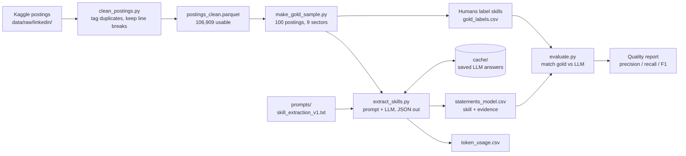

# Skill Taxonomy (Section B)

Taxonomy of Work capstone (Northeastern × Workhuman), Group 3. We build a skill taxonomy from public
job postings: **collect → extract → organize**. Section A builds the task taxonomy.

**Status:** Sprint 2 (Text Extraction) done. Next: Sprint 3 (Representation & Clustering).

## Sprint 2 results

LLM skill extraction scored against 100 hand-labelled postings (1,317 gold skills):

| Matching | Precision | Recall | F1 |
|---|---|---|---|
| Strict (same name) | 0.60 | 0.66 | 0.63 |
| Lenient (word overlap) | 0.69 | 0.76 | 0.72 |

- Extractor: `qwen/qwen3.8-27b` on the Groq free tier, prompt `prompts/skill_extraction_v1.txt`.
- 100% of evidence phrases occur verbatim in the posting. Tokens: 91,554 in / 41,902 out, $0.
- Gemini (`gemini-3.8-flash`) was also tried; Google returned 503 "high demand" errors (7/100 done).
- Full report (by sector, error samples, tokens): `reports/sprint2_extraction_quality_qwen_qwen3.8-27b.md`.
- Slides: `docs/sprint2_slides_content.pdf`.

## Sprint 2 flow (LLM skill extraction)

### Files used in Sprint 2

| Step | File | Role |
|---|---|---|
| Clean | `src/clean_postings.py` | Normalise text, tag duplicates / short / missing (nothing deleted) |
| Sample | `src/make_gold_sample.py` | Pick the 100 gold postings, stratified by sector (seed 42) |
| Label | `data/gold/LABELING_RULES.md` | What counts as a skill |
| Label | `src/gold_tool.py`, `data/gold/CLAUDE_LABELING_PROMPT.md` | Show postings, save labels |
| Label | `data/gold/gold_labels.csv` | **Gold set**: 100 postings, 1,317 skills |
| Label | `data/gold/second_annotations.csv` | Double-labelled postings (agreement) |
| Check | `src/check_skill.py` (in `taxonomy-skill-project`) | Look up a skill in ESCO / O\*NET |
| Extract | `prompts/skill_extraction_v1.txt` | Instructions sent to the LLM |
| Extract | `src/extract_skills.py` | Calls the LLM (Groq / Gemini), caches, retries, logs tokens |
| Extract | `data/processed/statements_<model>.csv` | **Statements**: one row per extracted skill (on Drive) |
| Evaluate | `src/evaluate.py` | Precision / recall / F1, strict and lenient, by sector |
| Report | `reports/sprint2_extraction_quality_qwen_qwen3.8-27b.md` | Scores, errors, token usage |
| Report | `reports/token_usage.csv` | Tokens per run |
| Report | `docs/sprint2_slides_content.pdf` | Presentation content |

## Folders

| Folder | What goes here | In Git? |
|---|---|---|
| `data/raw/` | Kaggle download, never edited | No (Drive / download script) |
| `data/interim/` | Cleaned, tagged postings (`postings_clean.parquet`) | No (Drive) |
| `data/gold/` | Gold labels, labelling rules, labelling prompt | Yes (posting text `gold_postings.csv` is on Drive) |
| `data/processed/` | LLM output: `statements_<model>.csv`, `extraction_postings_<model>.csv` | No (Drive) |
| `cache/` | Every LLM response; re-runs are free | No (Drive, optional) |
| `prompts/` | Versioned extraction prompt | Yes |
| `src/` | Python scripts | Yes |
| `reports/` | Quality reports, token log | Yes |
| `docs/` | Plans, slides | Yes |

**Data (Google Drive):** <ADD DRIVE LINK HERE>. Put each file in the folder shown above.

## Setup (Windows: use `py`)

1. Install packages: `py -m pip install -r requirements.txt`
2. Copy `.env.example` to `.env` and add your keys (`GROQ_API_KEY`, `GEMINI_API_KEY`). Never commit `.env`.
3. Get the data: download it with `py src/download_data.py`, then run `py src/clean_postings.py`,
   or copy the Drive files into the folders above.

## Pipeline

| Step | Command | Output |
|---|---|---|
| 1. Download | `py src/download_data.py` | `data/raw/linkedin/` |
| 2. Clean and tag | `py src/clean_postings.py` | `data/interim/postings_clean.parquet` (123,849 rows, 106,909 usable) |
| 3. Gold sample | `py src/make_gold_sample.py` (refuses to overwrite labels) | `data/gold/gold_labels.csv` |
| 4. Label | `py src/gold_tool.py show N` / `save N ...` / `status` | `gold_skills` column |
| 5. Extract | `py src/extract_skills.py --provider groq --model qwen/qwen3.8-27b` | `data/processed/statements_<model>.csv` |
| 6. Evaluate | `py src/evaluate.py --model qwen/qwen3.8-27b` | `reports/sprint2_extraction_quality_<model>.md` |

- `extract_skills.py`: provider-agnostic (`--provider gemini|groq`), JSON output, disk cache, rate-limit
  retries, token log in `reports/token_usage.csv`. Use `--list-models` to see what your key can use, and
  `--limit 3` for a small test. The model is never guessed.
- `evaluate.py`: one-to-one matching per posting; strict and lenient scores, overall and by sector.

## Gold set

- 100 usable postings, stratified by LinkedIn's first-listed job function (seed 42, 300–5,000 chars):
  IT 15, Health Care 15, Engineering 12, Finance + Accounting 12, Sales + Marketing 12, Management 10,
  Legal 8, Admin/HR/Customer Service 8, Mixed 8. Corrected sector in `sector_fixed`.
- Rules: `data/gold/LABELING_RULES.md` (a duty that names a skill counts).
- Method: LLM-suggested (Claude/ChatGPT), human-corrected. Both lists are saved (`suggested_skills`,
  `gold_skills`). Labellers: Priyanka, Lochan, Dhanush. 3 postings double-labelled
  (`data/gold/second_annotations.csv`). The extractor (Qwen) is from a different model family.
- Doubtful skills were checked against ESCO v1.2.1 and O\*NET 31.0.

## Optional: label in the review dashboard

`py src/make_dashboard_data.py` builds data so the teammate dashboard (`taxonomy-skill-project`) can show
the 100 gold postings in its "Evaluation annotation" mode.
