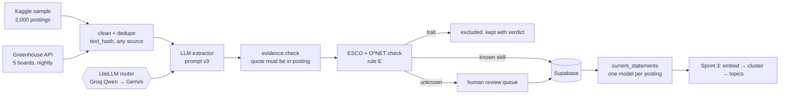
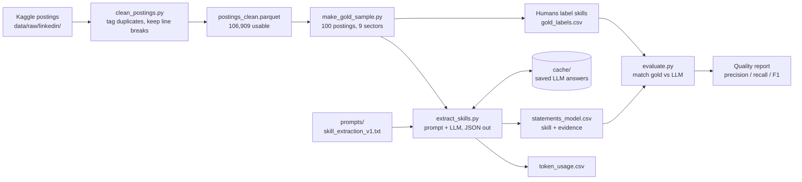

# Skill Taxonomy (Section B)

Taxonomy of Work capstone (Northeastern × Workhuman), Group 3. We build a skill taxonomy from public
job postings: **collect → extract → organize**. Section A builds the task taxonomy.

**Status:** Sprint 2 done; extractor frozen and a live pipeline (Supabase + UI) running.
**Now: Sprint 3 (Representation & Clustering).** End goal (brief): *given a business initiative, which tasks
does it involve and which skills are needed* — Section A's task taxonomy + our skill taxonomy, joined in Sprint 5.

## Sprint 3 — where we are

### Extractor selection (after Sprint 2)

The gold set was split **50 dev** (used to tune prompts) / **50 test** (scored once, at the end).
All models use prompt `prompts/skill_extraction_v3.txt`.

| Model | Dev strict F1 | Dev lenient F1 | Test strict / lenient F1 | Note |
|---|---|---|---|---|
| **Qwen3.8 27B** (Groq, free) | 0.65 | 0.74 | **0.66 / 0.75** | pipeline extractor |
| Claude Haiku 5.5 | 0.65 | 0.75 | 0.66 / 0.75 | research benchmark only (2,000 postings) |
| gpt-oss-120b (Groq) | 0.59 | 0.71 | — | more extra skills |
| Gemini 3.5 Flash-Lite | 0.64 | 0.71 | — | precise, misses list items |
| Nemotron 3 Ultra 550B (OpenRouter) | 0.51 | 0.60 | — | over-extracts |

- Prompt v4 (more rules, ideas from SkillSpan / SKORE / GoLLIE papers) gave no gain → v3 frozen.
- Human-vs-human agreement on 3 double-labelled postings: lenient 0.73, so models sit at the label ceiling.
- **Bias check** (`src/bias_check.py`): gold labels were LLM-drafted (Claude), so recall is split into
  skills *kept from the draft* vs *added by humans*. Test: Haiku .79 / .80, Qwen .77 / .75 — no drafter bias.
- **Rule E** (`data/gold/LABELING_RULES.md`): ESCO v1.2 + O\*NET 31.0 are the rule book for skill vs trait.
  Traits = O\*NET Work Styles + ESCO's transversal "attitudes and values" (e.g. attention to detail).
  `src/link_reference.py` gives every skill a verdict: on the Haiku 2,000, known skill 69% · trait 2% ·
  new candidate 29% (often real US skills missing from both libraries, e.g. GAAP, CI/CD → human review).

### Live pipeline

| Part | File | What it does |
|---|---|---|
| Database | `sql/supabase_schema.sql`, `src/db.py` | 6 tables + view `current_statements`; RLS on, no public access |
| Kaggle load | `src/load_supabase.py` | Postings + skills from the LLM cache (resumable; `--benchmark` keeps another model side by side) |
| Live feed | `src/pipeline.py`, `config/boards.yaml` | Greenhouse → clean → dedupe → extract (queue) → link → Supabase; every stage logged |
| LLM router | `src/llm_router.py` | LiteLLM: Groq Qwen, falls back to Gemini on rate limits; Langfuse tracing when keys are set |
| UI | `app/server.py`, `app/static/` | Pipeline status (stages, active model, fallbacks, DB size), human review queue, skills explorer |
| Schedule | `scripts/*.cmd` (Windows Task Scheduler) | Hourly Qwen load, nightly Greenhouse run, daily Qwen batch restart |

**One model per posting:** embeddings and search read only `current_statements` — Qwen rows where Qwen has
done the posting, otherwise the Haiku benchmark rows. As the free Qwen batch progresses, postings switch to
Qwen automatically. Every row keeps its model name.

### Sprint 3 plan

1. Embed the unique skills in `current_statements` with `BAAI/bge-small-en-v1.5` (384 numbers each) → Supabase (pgvector).
2. Cluster with two methods (HDBSCAN, agglomerative), parameter sweep, stability report.
3. Decide multi-topic membership; write topic and topic-membership tables.
4. UMAP 384 → 3 for an interactive 3D "Skill map" tab in the UI.

## Sprint 2 results (first run, gold v1, all 100 postings)

LLM skill extraction scored against 100 hand-labelled postings (1,317 gold skills):

| Matching | Precision | Recall | F1 |
|---|---|---|---|
| Strict (same name) | 0.60 | 0.66 | 0.63 |
| Lenient (word overlap) | 0.69 | 0.76 | 0.72 |

- Extractor: `qwen/qwen3.8-27b` on the Groq free tier, prompt `prompts/skill_extraction_v1.txt`.
- 100% of evidence phrases occur verbatim in the posting. Tokens: 91,554 in / 41,902 out, $0.
- Gemini (`gemini-3.8-flash`) was also tried; Google returned 503 "high demand" errors (7/100 done).
- Full report (by sector, error samples, tokens): `reports/sprint2_extraction_quality_qwen_qwen3.8-27b.md`.
- Slides: `docs/sprint2_slides_content.pdf`.

## Sprint 2 flow (LLM skill extraction)

### Files used in Sprint 2

| Step | File | Role |
|---|---|---|
| Clean | `src/clean_postings.py` | Normalise text, tag duplicates / short / missing (nothing deleted) |
| Sample | `src/make_gold_sample.py` | Pick the 100 gold postings, stratified by sector (seed 42) |
| Label | `data/gold/LABELING_RULES.md` | What counts as a skill |
| Label | `src/gold_tool.py`, `data/gold/CLAUDE_LABELING_PROMPT.md` | Show postings, save labels |
| Label | `data/gold/gold_labels.csv` | **Gold set**: 100 postings, 1,317 skills |
| Label | `data/gold/second_annotations.csv` | Double-labelled postings (agreement) |
| Check | `src/check_skill.py` (in `taxonomy-skill-project`) | Look up a skill in ESCO / O\*NET |
| Extract | `prompts/skill_extraction_v1.txt` | Instructions sent to the LLM |
| Extract | `src/extract_skills.py` | Calls the LLM (Groq / Gemini), caches, retries, logs tokens |
| Extract | `data/processed/statements_<model>.csv` | **Statements**: one row per extracted skill (on Drive) |
| Evaluate | `src/evaluate.py` | Precision / recall / F1, strict and lenient, by sector |
| Report | `reports/sprint2_extraction_quality_qwen_qwen3.8-27b.md` | Scores, errors, token usage |
| Report | `reports/token_usage.csv` | Tokens per run |
| Report | `docs/sprint2_slides_content.pdf` | Presentation content |

**Data (Google Drive):** <ADD DRIVE LINK HERE>. Put each file in the folder shown above.

## Setup (Windows: use `py`)

1. Install packages: `py -m pip install -r requirements.txt`
2. Copy `.env.example` to `.env` and add your keys (`GROQ_API_KEY`, `GEMINI_API_KEY`; for the pipeline also
   `SUPABASE_DB_URL` = Supabase "Session pooler" URI; optional `LANGFUSE_PUBLIC_KEY`, `LANGFUSE_SECRET_KEY`,
   `LANGFUSE_HOST`). Never commit `.env`.
3. Get the data: download it with `py src/download_data.py`, then run `py src/clean_postings.py`,
   or copy the Drive files into the folders above. Reference libraries: `py src/download_reference.py`.
4. Pipeline: `py src/db.py --init` (tables), `py src/load_supabase.py` (Kaggle), `py src/pipeline.py --max-new 10`
   (Greenhouse), then `py app/server.py` → http://127.0.0.1:8765.

## Pipeline

| Step | Command | Output |
|---|---|---|
| 1. Download | `py src/download_data.py` | `data/raw/linkedin/` |
| 2. Clean and tag | `py src/clean_postings.py` | `data/interim/postings_clean.parquet` (123,849 rows, 106,909 usable) |
| 3. Gold sample | `py src/make_gold_sample.py` (refuses to overwrite labels) | `data/gold/gold_labels.csv` |
| 4. Label | `py src/gold_tool.py show N` / `save N ...` / `status` | `gold_skills` column |
| 5. Extract | `py src/extract_skills.py --provider groq --model qwen/qwen3.8-27b` | `data/processed/statements_<model>.csv` |
| 6. Evaluate | `py src/evaluate.py --model qwen/qwen3.8-27b` | `reports/sprint2_extraction_quality_<model>.md` |

- `extract_skills.py`: provider-agnostic (`--provider gemini|groq`), JSON output, disk cache, rate-limit
  retries, token log in `reports/token_usage.csv`. Use `--list-models` to see what your key can use, and
  `--limit 3` for a small test. The model is never guessed.
- `evaluate.py`: one-to-one matching per posting; strict and lenient scores, overall and by sector.

## Gold set

- 100 usable postings, stratified by LinkedIn's first-listed job function (seed 42, 300–5,000 chars):
  IT 15, Health Care 15, Engineering 12, Finance + Accounting 12, Sales + Marketing 12, Management 10,
  Legal 8, Admin/HR/Customer Service 8, Mixed 8. Corrected sector in `sector_fixed`.
- Rules: `data/gold/LABELING_RULES.md` (a duty that names a skill counts).
- Method: LLM-suggested (Claude/ChatGPT), human-corrected. Both lists are saved (`suggested_skills`,
  `gold_skills`). Labellers: Priyanka, Lochan, Dhanush. 3 postings double-labelled
  (`data/gold/second_annotations.csv`). The extractor (Qwen) is from a different model family.
- Doubtful skills were checked against ESCO v1.2.1 and O\*NET 31.0.

## Optional: label in the review dashboard

`py src/make_dashboard_data.py` builds data so the teammate dashboard (`taxonomy-skill-project`) can show
the 100 gold postings in its "Evaluation annotation" mode.
